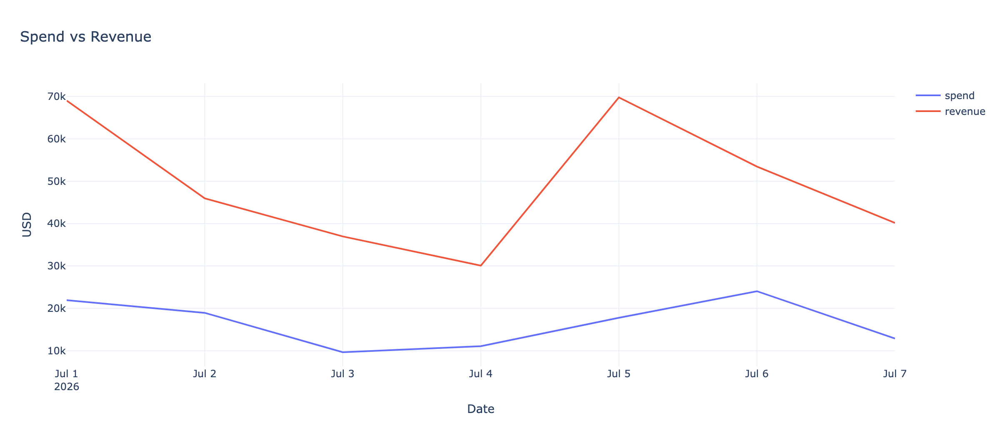
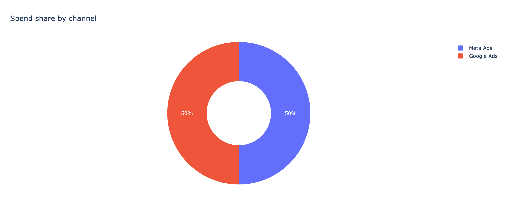
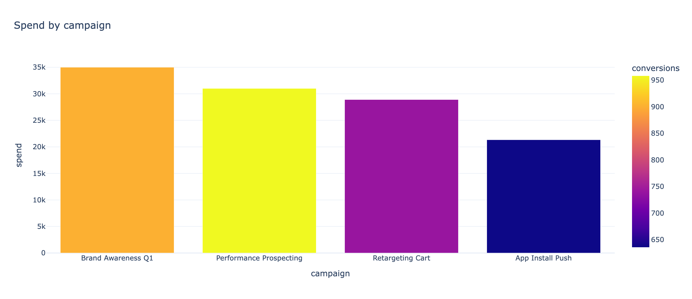

# Ads ETL Pipeline + Analytics Dashboard


Portfolio project de **Data Engineering / Analytics Engineering**: pipeline de mídia paga (ETL) → modelo dimensional → checagens de qualidade → dashboard analítico.

> **Dados sintéticos** (não são dados reais de cliente). Veja [`docs/DATA.md`](./docs/DATA.md).

## Live demo

[](https://portfolio-data-engineering-dktms26fxjcscyufkdrkwq.streamlit.app/)

**[Abrir dashboard](https://portfolio-data-engineering-dktms26fxjcscyufkdrkwq.streamlit.app/)**

---

## Em 30 segundos

| Para quem | O que olhar |
|-----------|-------------|
| **Recrutador / hiring manager** | Camadas ETL claras, star schema, quality gates, dashboard de KPIs |
| **Pessoa de negócio / empresa** | Spend, Revenue, ROAS, CTR, CPC, CPA por canal e campanha |
| **Quem está começando** | Código comentado por etapas + passo a passo para rodar local |

```text
CSV (Google Ads / Meta Ads style)
        ↓ extract
        ↓ transform (dims + fact)
        ↓ quality gates
        ↓ load (SQLite)
        ↓ Streamlit dashboard
```

---

## Preview

<p align="center">
  
</p>

<p align="center">
  
  
</p>

> Se as imagens ainda não aparecerem no clone local, rode: `python scripts/export_previews.py`

---

## Stack

- **Python** + pandas  
- **SQL / SQLite** (schema simples, fácil de levar para PostgreSQL)  
- **Streamlit** + Plotly  
- **pytest**

---

## Como rodar (do zero)

```bash
# 1) ambiente
python3 -m venv .venv
source .venv/bin/activate          # Windows: .venv\Scripts\activate
pip install -r requirements.txt

# 2) gera dados sintéticos + ETL + warehouse
python -m src.pipeline

# 3) dashboard
streamlit run dashboard/app.py

# 4) testes
pytest -q
```

### Atalhos (Make)

```bash
make setup      # cria venv + instala deps
make pipeline   # roda o ETL
make dashboard  # sobe o Streamlit
make test       # pytest
```

### Opções do pipeline

```bash
python -m src.pipeline --days 30          # janela menor de sample
python -m src.pipeline --skip-generate    # reusa CSVs já gerados em data/raw
```

---

## KPIs

| KPI | Fórmula | Para que serve |
|-----|---------|----------------|
| **Spend** | soma do investimento | quanto foi gasto |
| **Revenue** | receita atribuída | retorno gerado |
| **ROAS** | revenue / spend | eficiência do investimento |
| **CTR** | clicks / impressions | atratividade do anúncio |
| **CPC** | spend / clicks | custo por clique |
| **CPA** | spend / conversions | custo por conversão |

---

## Modelo dimensional

| Tabela | Papel |
|--------|--------|
| `dim_date` | Calendário (`date_id = YYYYMMDD`) |
| `dim_channel` | Google Ads / Meta Ads |
| `dim_campaign` | Campanha + objetivo + status |
| `fact_ads_performance` | Grão: data × canal × campanha |

Detalhes: [`docs/ARCHITECTURE.md`](./docs/ARCHITECTURE.md)

### Quality gates (antes do load)

- fato não vazio  
- `clicks <= impressions`  
- métricas ≥ 0  
- integridade de FKs  
- grão único `(date_id, channel_id, campaign_id)`

---

## Estrutura

```text
01-ads-etl-dashboard/
├── assets/                 # previews do README
├── dashboard/app.py        # Streamlit BI
├── docs/
│   ├── ARCHITECTURE.md
│   └── DATA.md             # transparência sobre dados sintéticos
├── data/raw/               # gerado localmente (não versionado)
├── data/processed/         # warehouse.db local (não versionado)
├── sql/schema.sql
├── src/                    # extract → transform → quality → load
├── scripts/export_previews.py
├── tests/
├── Makefile
├── LICENSE
└── requirements.txt
```

---

## O que este projeto demonstra

1. **ETL orquestrado** com responsabilidades separadas  
2. **Modelagem dimensional** (star schema)  
3. **Data quality** como etapa explícita do pipeline  
4. **Camada analítica / BI** consumindo o warehouse  
5. **Código testável e reproduzível** para portfolio público  

---

## English summary

End-to-end **Data Engineering / Analytics Engineering** portfolio project:

synthetic Google Ads / Meta Ads-style extracts → ETL → dimensional SQLite warehouse → data quality gates → Streamlit KPI dashboard (Spend, Revenue, ROAS, CTR, CPC, CPA).

Data is **synthetic by design** (safe for public GitHub, no client credentials). See [`docs/DATA.md`](./docs/DATA.md).

---

## Author

**Matheus Rodrigues da Silva**  
Data Engineer | Analytics Engineer  

LinkedIn: [linkedin.com/in/mmatheusrodrigues](https://www.linkedin.com/in/mmatheusrodrigues/)
