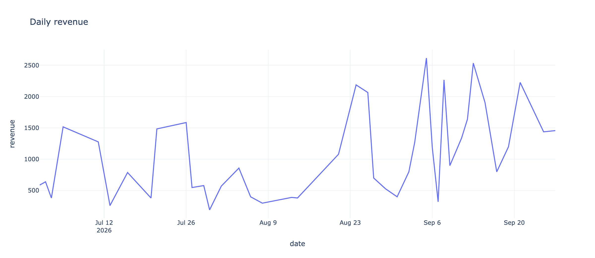
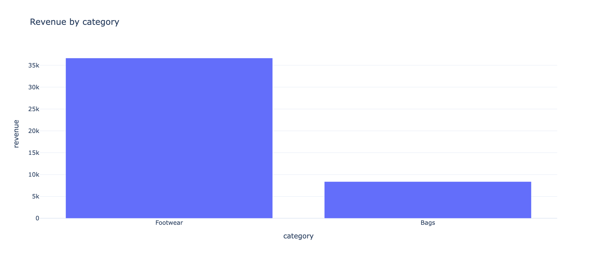
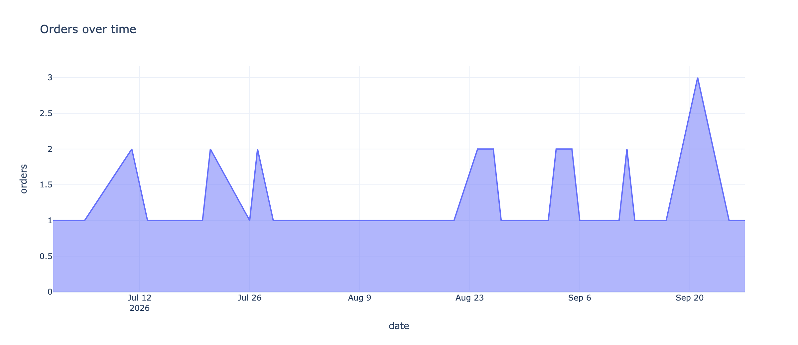

# E-commerce Analytics Warehouse


Portfolio de **Analytics Engineering**: extracts transacionais → **staging** → **marts** (SQL) → **data quality** → dashboard.

> **Dados sintéticos** (não são dados reais). Veja [`docs/DATA.md`](./docs/DATA.md).

## Live demo

[](https://portfolio-data-engineering-as4n734uekubaxk4fknmqz.streamlit.app/)

**[Abrir dashboard](https://portfolio-data-engineering-as4n734uekubaxk4fknmqz.streamlit.app/)**

---

## Em 30 segundos

| Para quem | O que olhar |
|-----------|-------------|
| **Recrutador** | Camadas raw/staging/marts, SQL-first, quality gates, reconciliação de receita |
| **Negócio** | Receita diária, categorias, top clientes |
| **Iniciante** | Fluxo claro + comandos para rodar do zero |

```text
CSV (customers / products / orders / items)
   → staging views
   → dims + fact + marts
   → quality checks
   → Streamlit
```

---

## Preview

<p align="center">
  
</p>

<p align="center">
  
  
</p>

> Se as imagens não aparecerem localmente: `python scripts/export_previews.py`

---

## Como rodar

```bash
python3 -m venv .venv
source .venv/bin/activate
pip install -r requirements.txt

python -m src.run_warehouse
streamlit run dashboard/app.py
pytest -q
```

### Make

```bash
make setup
make warehouse
make dashboard
make test
```

### CLI

```bash
python -m src.run_warehouse --customers 200 --orders 800
python -m src.run_warehouse --skip-generate
```

---

## Marts

| Tabela | Uso |
|--------|-----|
| `mart_daily_revenue` | receita / pedidos / unidades por dia |
| `mart_category_revenue` | performance por categoria |
| `mart_top_customers` | ranking de clientes por receita |

## Quality gates

- e-mail único e não nulo  
- FKs de cliente/produto  
- receita ≥ 0  
- cancelados fora do fato  
- `SUM(fact) ≈ SUM(mart_daily_revenue)`  

Detalhes: [`docs/ARCHITECTURE.md`](./docs/ARCHITECTURE.md)

---

## Estrutura

```text
02-ecommerce-analytics-warehouse/
├── assets/
├── dashboard/app.py
├── docs/
│   ├── ARCHITECTURE.md
│   └── DATA.md
├── sql/
│   ├── staging.sql
│   └── marts.sql
├── src/
│   ├── generate_sample_data.py
│   ├── run_warehouse.py
│   ├── data_quality.py
│   └── logging_config.py
├── scripts/export_previews.py
├── tests/
├── Makefile
└── LICENSE
```

---

## English summary

SQL-first **Analytics Engineering** portfolio: synthetic e-commerce extracts → staging views → dimensional/fact/mart tables → data quality gates (including revenue reconciliation) → Streamlit dashboard.

---

## Author

**Matheus Rodrigues da Silva** — Data Engineer | Analytics Engineer  
[LinkedIn](https://www.linkedin.com/in/mmatheusrodrigues/)
